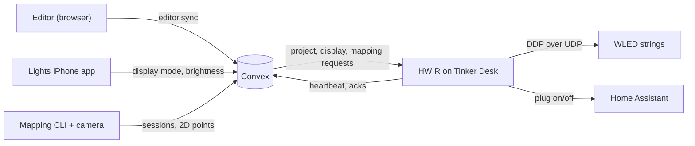

# Effect Sim

Effect Sim runs Mike's outdoor Christmas light display: about 2,000 WLED pixels strung around the house, plus a few smart plugs. It has five parts:

- **Editor** (`src/`): a React app with a 3D model of the house, where you place the LED strings, build sequences on a timeline of effects and put them into playlists. It previews everything in the browser.
- **Convex backend** (`convex/`): the projects, nodes, sequences and playlists, the display's on/off state and mode, HWIR's heartbeat and the camera mapping sessions.
- **HWIR** (`hardware-interface-runtime/`), the hardware interface runtime: a headless React (react-nil) process on a Mac next to the lights. It plays the display's playlist on the strings over DDP, switches the plug through Home Assistant and reports back to Convex.
- **Lights** (`ios/`): an iPhone app that turns the display on and off, picks the playlist or sequence and sets the brightness, with a Control Center toggle, a widget and Siri phrases.
- **Camera mapping** (`tools/mapping/`): a CLI that photographs coded patterns on the lights, works out where every LED is, and hands the points to the editor to place them on the house.

Effects live in `shared/`, so the editor, HWIR and Convex's prop checks all use the same code.



`docs/rebuild-plan.md` has the design behind the November 2026 rebuild: the data model, the role tokens, the state machines, effects, mapping and the cutover steps.

## Getting started

You need [Bun](https://bun.sh/) 1.4 or later and Node 22.15 or later (ESLint runs on Node).

```bash
bun install
npx convex deployment create local --select   # first time, writes .env.local
bun run dev
```

Later on, `npx convex deployment select local` picks the local backend again. `bun run dev` starts `convex dev` and Vite together and opens the editor.

A new backend needs Convex Auth's settings before it will take the functions. Locally the Google ones can be placeholders, as a local backend doesn't ask anyone to sign in until `REQUIRE_TOKENS` is `"true"`:

```bash
bun tools/setAuthKeys.ts
npx convex env set AUTH_GOOGLE_CLIENT_ID unused
npx convex env set AUTH_GOOGLE_CLIENT_SECRET unused
```

To try the Google sign-in against a backend, use the dev deployment (`expert-viper-771`), which has the real client and `AUTH_ALLOW_LOCALHOST_REDIRECTS=true` so Google can send you back to `localhost:5173`.

For real data, import a production backup into the local backend with `npx convex import --replace-all <zip>`.

`/machines` in the editor shows every state machine, with its states, transitions and rows.

## Adding an effect

Each effect is one file in `shared/effects/string/` (or `switch/` for plugs) that calls `defineEffect`:

```ts
export const myEffect = defineEffect({
  id: "myEffect", // stored on events, so never change it once used
  name: "My effect",
  icon: "✨",
  props: z.object({ color: inspectableProps.color, speed: inspectableProps.bounded(0, 10) }),
  defaults: { color: [255, 255, 255], speed: 1 },
  render: function MyEffect({ string, props }) {
    useEffectFrame((frame, random) => {
      // string.setPixel(i, r, g, b), string.getNormalisedPosition(i), ...
    });
    return null;
  },
});
```

Then add one line for it to `stringEffects` (or `switchEffects`) in `shared/effects/registry.ts`. The order there is the editor's order. Give every number prop bounds with `inspectableProps.bounded`, as Convex rejects anything outside them.

The effect API is in `shared/effects/api.ts`. `string.getPosition(i)` gives an LED's position in metres and `getNormalisedPosition(i)` gives it within the house's box, so spatial effects like `wipe` and `radialPulse` look the same on the lights as in the editor. For anything random use the `random` that `useEffectFrame` passes in (or `useEffectRandom()` for set-up), never `Math.random`, so scrubbing and the real lights draw the same frames.

## Running HWIR

```bash
bun run hwir                                   # prompts for a project and playlist
bun run hwir -p <projectId> -l <playlistId> --dry-run
```

`bun run hwir` starts a supervisor that runs the runtime, restarts it when it exits and, with `HWIR_AUTO_UPDATE=true`, keeps it on `origin/main`. Each new commit is checked in a staging worktree (install, typecheck, a `--smoke` boot) before HWIR switches to it, and if the new code crash-loops it rolls back to the last good commit.

`--dry-run` runs everything but blocks UDP, WLED and plug calls, Home Assistant and Convex mutations, so it can't fight the live runtime. `--smoke` boots, runs about two seconds of frames with no side effects and exits. HWIR's token (`HWIR_TOKEN`) and the Home Assistant settings go in `.env.local`.

[hardware-interface-runtime/README.md](hardware-interface-runtime/README.md) covers the flags, string connections, mapping mode, the heartbeat and the supervisor in full.

## Camera mapping

[tools/mapping/README.md](tools/mapping/README.md) is the runbook for a mapping night: setup, cameras, viewpoints, the capture itself and the review in the editor's Mapping panel.

## Lights iPhone app

Copy `ios/Secrets.example.xcconfig` to `ios/Secrets.xcconfig` and put the deployment's `REMOTE_TOKEN` in it, then build and install with `ios/scripts/install-phone.sh`. The app writes the `displayControls` row (`convex/display.ts`), which HWIR follows live.

## Testing, lint and CI

```bash
bun run typecheck
bun run lint
bun run test        # vitest, including convex-test for the backend
```

Use `bun run test`, not `bun test` (that's Bun's own runner). Lint is [mikecann-lint](https://github.com/mikecann/mikecann-lint) plus this repo's rules in `eslint-rules/`. Problems that were already there when it went in are baselined in `eslint-suppressions.json`. GitHub Actions (`.github/workflows/ci.yml`) runs all three on every push and pull request.

## Deployments

- **Convex and the editor**: production is `aromatic-cardinal-985`, used by HWIR, the editor and the Lights app. The editor is a Cloudflare Worker serving the built app (`wrangler.jsonc`) at [effect-sim.mikeysee.workers.dev](https://effect-sim.mikeysee.workers.dev). Cloudflare's Workers Build runs `npx convex deploy --cmd 'npm run build'` with the production deploy key on every merge to `main`, so a merge deploys both. Builds of other branches always fail there, as Convex refuses a production key off `main`.
- **Signing in**: the editor signs in with Google (Convex Auth v2, `convex/editors.ts`). Only the addresses in `EDITOR_EMAILS` (comma separated) get an account, and that list is checked on every call. The Google OAuth client is "effect-sim editor (Convex)"; its redirect URIs are `<deployment>.convex.site/oauth/google/callback` for production and dev. A deployment needs `AUTH_PRIVATE_KEY` and `AUTH_JWKS` (`bun tools/setAuthKeys.ts [--prod]`), `AUTH_GOOGLE_CLIENT_ID`, `AUTH_GOOGLE_CLIENT_SECRET` and `EDITOR_EMAILS`.

- **HWIR**: runs on Tinker Desk, a Mac by the house, under launchd (`com.mikecann.effect-sim.hwir.plist`), with `HWIR_AUTO_UPDATE=true`. Anything merged to `main` reaches the lights within about a minute, once the supervisor's checks pass. `check-hwir-status.sh` shows whether the service is running.
- **Lights**: installed straight onto the phone with `ios/scripts/install-phone.sh`.

## License

Apache License 2.0, see [LICENSE.txt](LICENSE.txt).
